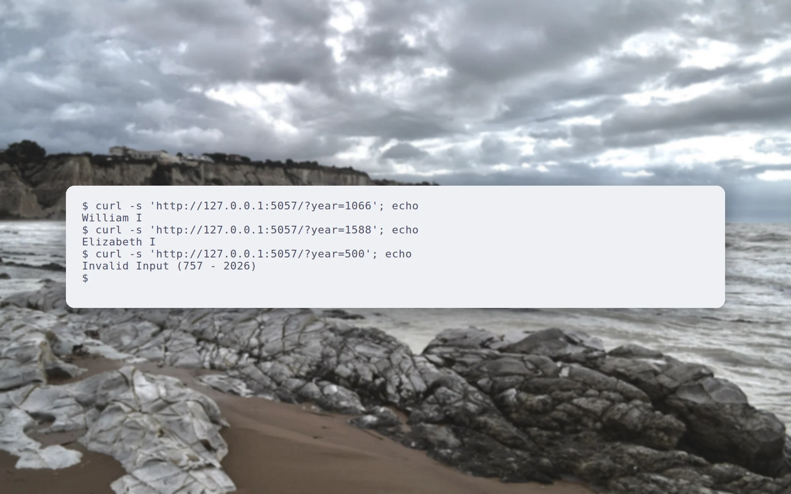
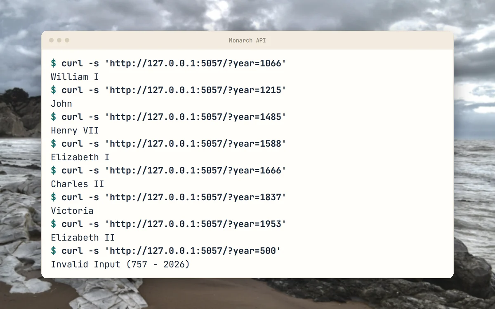
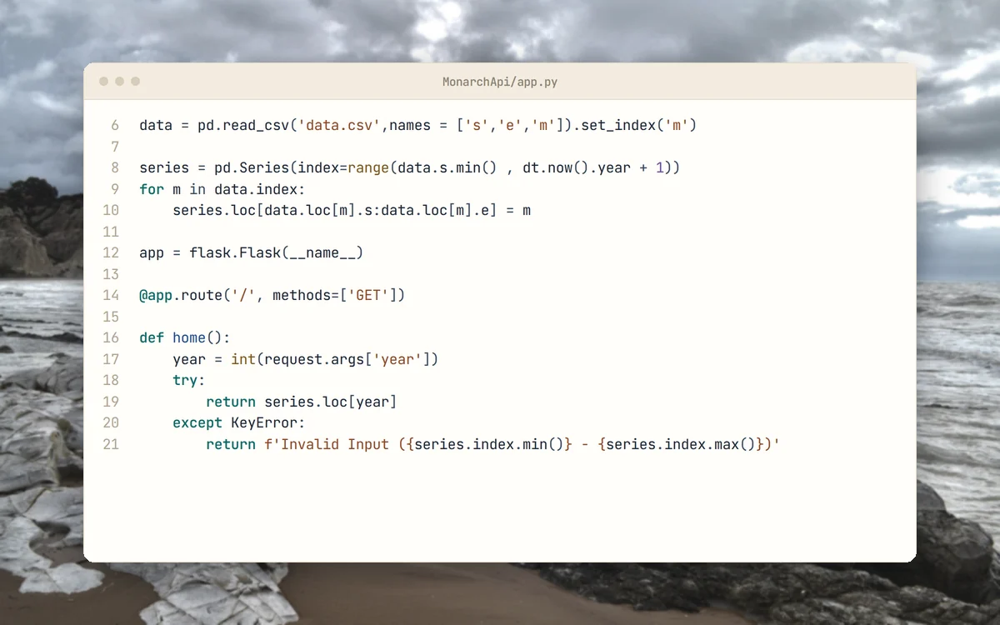
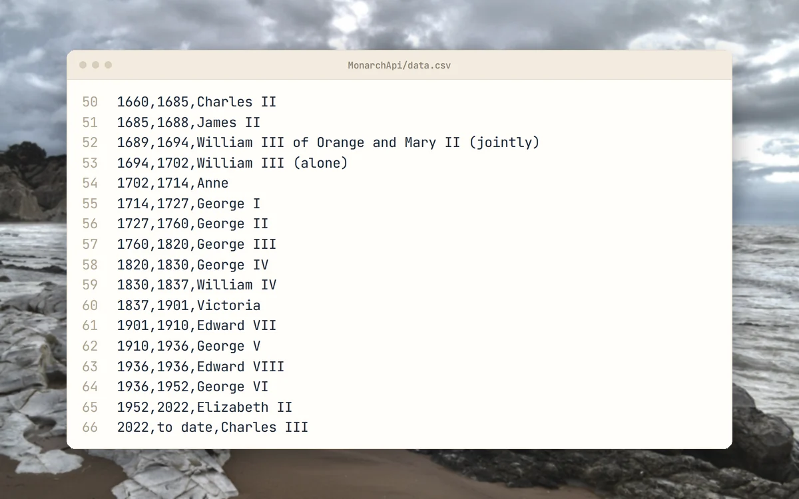
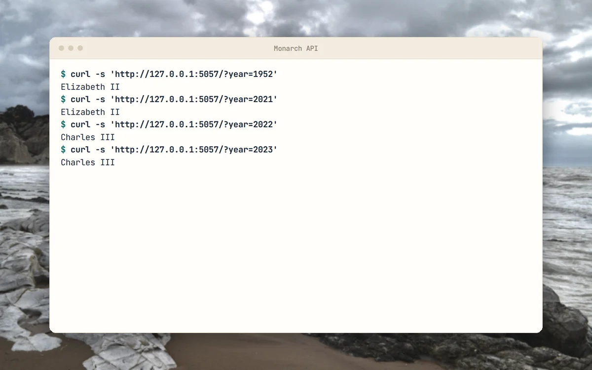

<p align="center">
  <picture>
    <source media="(prefers-color-scheme: dark)" srcset="docs/brand/svg/monarch-api-logo-on-dark.svg">
    
  </picture>
</p>

<h1 align="center">Which monarch ruled in a given year? Ask the API.</h1>

<p align="center">
  Coursework from 2020: a one-route Flask API over a dataset of British monarchs.<br>
  <b>Years from 757 to today. Plain-text answers.</b>
</p>

<p align="center">
  
  
  
  
  
  <a href="https://github.com/mertkayacs/MonarchApi-Flask-Heroku"></a>
</p>

<p align="center">
  <a href="#quick-start"></a>
  <a href="MonarchApi/data.csv"></a>
  <a href="MonarchApi/app.py"></a>
</p>

<p align="center">
  <picture>
    <source media="(prefers-color-scheme: dark)" srcset="docs/assets/readme/hero-dark.webp">
    
  </picture>
</p>

Monarch API returns the British monarch who reigned in a given year. It is a Flask app that loads a CSV of reigns into a pandas Series indexed by year, and it was built as coursework in 2020 for deployment on Heroku. One route answers a year query with the monarch name as plain text.

---

## Why Monarch API

The whole service is one route over one CSV file.

|  |  |
|---|---|
|  **A year in, a monarch out** | A request to `/?year=1700` returns the monarch reigning that year. |
|  **Dataset included** | [data.csv](MonarchApi/data.csv) holds 66 rows of start year, end year and name, from Offa in 757 to Charles III from 2022. |
|  **Clear out-of-range answer** | A year outside the data returns `Invalid Input (757 - <current year>)`. |

## A quick tour

<table>
  <tr>
    <td width="50%" valign="top">
      <picture>
        <source media="(prefers-color-scheme: dark)" srcset="docs/assets/readme/tour/run-dark.webp">
        
      </picture>
      <h3>API in action</h3>
      Three requests: 1066 returns William I, 1588 returns Elizabeth I, and 500 is out of range.
    </td>
    <td width="50%" valign="top">
      <picture>
        <source media="(prefers-color-scheme: dark)" srcset="docs/assets/readme/tour/query-dark.webp">
        
      </picture>
      <h3>The query code</h3>
      A year-indexed pandas Series is built once at start-up and each request looks up its year.
    </td>
  </tr>
  <tr>
    <td width="50%" valign="top">
      <picture>
        <source media="(prefers-color-scheme: dark)" srcset="docs/assets/readme/tour/data-dark.webp">
        
      </picture>
      <h3>The dataset</h3>
      Start year, end year and name for each reign, ending with Elizabeth II and Charles III.
    </td>
    <td width="50%" valign="top">
      <picture>
        <source media="(prefers-color-scheme: dark)" srcset="docs/assets/readme/tour/years-dark.webp">
        
      </picture>
      <h3>Boundary years</h3>
      When two reigns share a year the later monarch is returned, so 2022 gives Charles III.
    </td>
  </tr>
</table>

<p align="center"><sub>Terminal cards are real runs of the app on localhost. Code cards show the files as they are in the repository.</sub></p>

## Features

- Single GET route with a year query parameter.
- Years mapped to monarchs once at start-up.
- Heroku files included: a Procfile for gunicorn and a runtime.txt that pins Python 3.7.6.

## Quick start

```sh
cd MonarchApi
pip install "pandas<3" flask gunicorn
flask --app app run
```

Then request a year:

```sh
curl 'http://127.0.0.1:5000/?year=1588'
```

The Heroku command in the Procfile is `gunicorn app:app`.

### Requirements

- pandas below version 3. With pandas 3 the start-up loop that fills the year series raises a dtype error. I tested pandas 2.3.3 with Python 3.12 and Flask 3.1.3, where it prints a pandas FutureWarning and answers correctly.
- The project was written for Python 3.7 and pandas 1.x, as runtime.txt shows.

## FAQ

<details>
<summary><b>How do I query it?</b></summary>

Send `GET /?year=1700`. The response is the monarch name as plain text.
</details>

<details>
<summary><b>What years are covered?</b></summary>

From 757 (Offa) to the current year. Other years return the invalid input message.
</details>

<details>
<summary><b>Why does it fail on a fresh install?</b></summary>

Current pandas rejects assigning names into the float series that app.py builds. Install `pandas<3`.
</details>

<details>
<summary><b>Is it still on Heroku?</b></summary>

The repository documents no live deployment.
</details>

If Monarch API is useful to you, a ⭐ helps other people find it.

Photos behind the screenshots are credited in [docs/assets/readme/CREDITS.md](docs/assets/readme/CREDITS.md).

[](https://github.com/mertkayacs/MonarchApi-Flask-Heroku)
